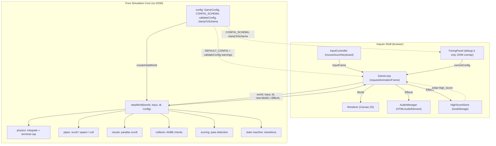
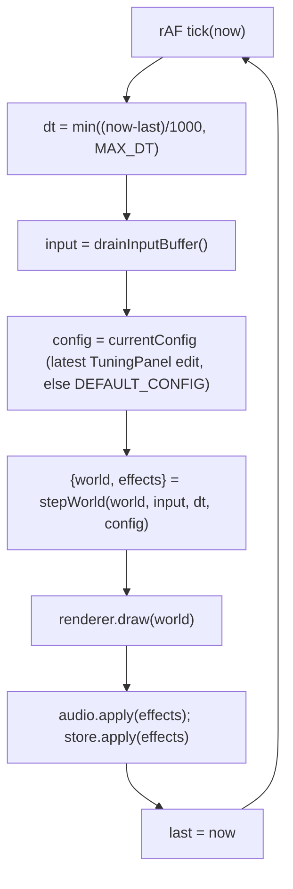
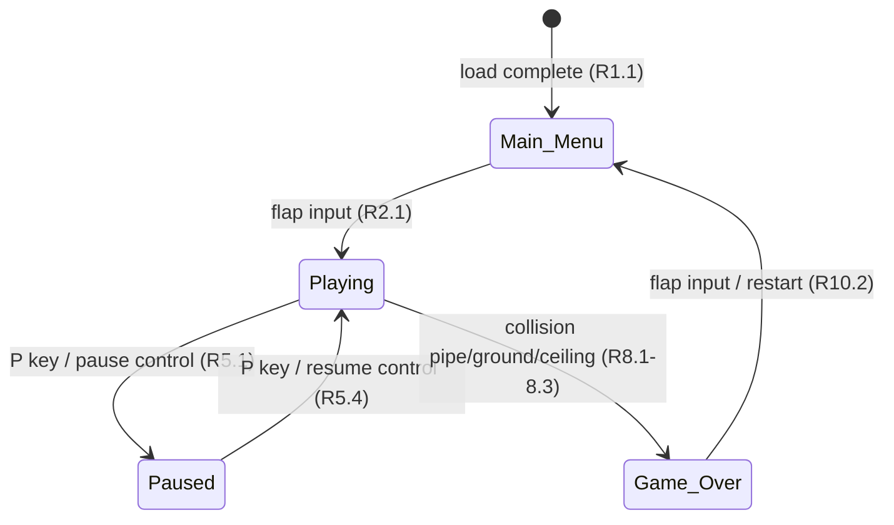

# Design Document

## Overview

Flappy Kiro is a retro, pixel-styled endless scroller that runs entirely in the browser with no build step. It is implemented as a single `index.html` plus a small set of vanilla JavaScript ES modules and one CSS file, using the HTML5 Canvas 2D API for rendering and the Web Audio-adjacent `HTMLAudioElement` API for sound. This zero-dependency, no-toolchain approach is the natural fit for a small retro game and satisfies the "runs in a browser" intent while keeping the entire simulation deterministic and testable.

The central design idea is a strict separation between a **pure simulation core** and the **impure shell** (rendering, input, audio, storage, and the `requestAnimationFrame` loop). All game rules — physics integration, pipe scrolling and generation, collision detection, scoring, and state transitions — live in pure functions that take the current world plus inputs and return a new world. The shell owns the browser APIs, the timing, and the pixels. This separation is what makes the physics (Requirement 14) and collision/scoring logic (Requirements 7, 8) verifiable with property-based tests: the pure core can be run thousands of times with generated inputs, with no canvas or DOM required.

Key design decisions and their rationale:

- **Fixed logical resolution with delta-time integration.** The world is simulated in a fixed logical coordinate space (e.g. 480×640 logical pixels) and scaled to the canvas. Motion is integrated using `Delta_Time` so behavior is frame-rate independent (Requirement 14.5, 14.6, 12.5). All the requirement constants (gravity 1600, flap −450, terminal 700) are expressed in logical pixels per second.
- **Explicit finite state machine.** A single `Game_State` enum (`Main_Menu`, `Playing`, `Paused`, `Game_Over`) gates every update and every input, directly modeling Requirements 1, 2, 5, 8, and 10 and preventing physics/scoring from running in the wrong state.
- **Semi-fixed timestep with a clamped delta.** The loop measures real elapsed time but clamps `Delta_Time` to a maximum so a background-tab stall or a slow frame cannot teleport the Ghost through a pipe. This preserves fair collision detection (Requirement 8) while keeping motion continuous (Requirement 12.5 ≥ 30 FPS).
- **Bounding-region collision.** Collision uses axis-aligned bounding boxes (AABB) for the Ghost against each pipe rectangle plus the ground and ceiling (Requirement 8.1–8.3), which is cheap, predictable, and easy to state as a property.
- **Centralized tuning configuration.** A single `GameConfig` object is the source of truth for all gameplay tuning values — physics constants (gravity, flap velocity, terminal velocity), pipe speed/gap/spacing, cloud layer speeds, Ghost and pipe dimensions, and the cloud opacity range — so the code carries no scattered magic numbers, the game is easy to tune in one place, and the core is easy to test with alternate configs. Genuinely structural constants (the localStorage key, asset paths, `MAX_DT`, and the logical resolution) are grouped separately as shell-level constants rather than mixed in with gameplay tuning. The config documents the requirement-mandated bounds in comments (e.g. Ghost 24–48 px, pipe width 40–80 px, cloud opacity 0.3–0.8, flap velocity −400 to −500), so the source of each value stays visible next to it.
- **Difficulty progression via a single evolving pipe speed.** The `World` holds one `pipeSpeed` value shared by every Pipe_Pair. It starts at `Base_Pipe_Speed` and increases by a fixed `Speed_Step` at each score threshold (every `speedUpInterval` = 5 points), capped at `Max_Pipe_Speed` (Requirement 15). The target speed is a pure, deterministic function of the current Score — `min(basePipeSpeed + floor(score / speedUpInterval) * speedStep, maxPipeSpeed)` — so a single common speed always applies to all active and future pipes (Requirement 15.5, consistent with 6.1) and the increase is idempotent per score. To keep the parallax relationship intact as the pipes speed up, cloud layer speeds are derived as fixed ratios of the current `pipeSpeed` (each ratio in (0, 1)), so every Cloud_Layer stays strictly below the current pipe speed even after increases (Requirements 12.8, 15.6). Only the speed changes; the Gap vertical size stays fixed (Requirement 15.7).
- **Consistency with R12.7 ("constant horizontal speed").** Pipe_Speed changes only at score thresholds (Requirement 15.2), so between two Pipe_Speed changes every cloud layer speed `ratio · pipeSpeed` is constant. Each layer keeps a distinct fixed ratio for the whole session, so the layers always move at different speeds and keep their relative depth ordering. "Constant" in R12.7 is therefore read as constant between Pipe_Speed changes, with each layer's ratio to the pipe speed fixed.
- **Config is an argument to the core, passed every frame.** `stepWorld(world, input, dt, config)` receives the current `GameConfig` on every call and reads all tuning values from it rather than from copies stored in `World`. Live edits from the developer Tuning_Panel (Requirement 17) replace the loop's `currentConfig` and take effect on the next frame without resetting the session (Requirements 17.5, 17.10). The core stays pure because config is just another argument: the same `(world, input, dt, config)` always produces the same result.
- **Config validated against a schema at load.** A `CONFIG_SCHEMA` in the `config` module documents each tunable's allowed range. `validateConfig` checks the active config at load and returns warnings the shell logs with `console.warn`; loading never blocks (Requirement 16). The same schema drives Tuning_Panel controls and clamping (Requirement 17.4, 17.6).
- **Reuse of existing assets.** The design references the assets already present at the workspace root: `assets/ghosty.png` (Ghost sprite), `assets/jump.wav` (Flap sound), and `assets/game_over.wav` (Game_Over sound). Rendering falls back to a drawn white rectangle and audio degrades silently if an asset fails to load (Requirements 12.1, 13.4).

## Architecture

### High-level structure

The application is split into a pure core and an impure shell. The shell drives one frame at a time: it gathers buffered input, computes a clamped delta, calls the pure `stepWorld(world, input, dt, config)` reducer with the loop's `currentConfig`, then renders the returned world and fires any audio/storage side effects the step requested.



A small `config` module lives in the pure core and holds `DEFAULT_CONFIG` (the `GameConfig` of gameplay tuning constants), `CONFIG_SCHEMA` (allowed range and panel metadata per tunable), and the pure helpers `validateConfig` and `clampToSchema`. It has no dependencies on any other module. The loop holds a `currentConfig` reference, initialized to `DEFAULT_CONFIG` and replaced immutably by the TuningPanel when enabled; it passes `currentConfig` to `stepWorld` every frame. Both the core (via `createInitialWorld(config)`, which seeds the initial `World`) and the shell import it — the core to build and advance the simulation, and the shell to size and lay out what it draws — so every tuning value has exactly one definition that flows outward from `config`.

### The game loop

The loop runs on `requestAnimationFrame`. Each tick it computes `dt = min((now - last) / 1000, MAX_DT)`, drains the input buffer into a single `InputFrame`, calls `stepWorld(world, input, dt, currentConfig)`, applies the returned effects, and renders. Consolidating buffered inputs into one `InputFrame` per tick is what makes "consecutive flaps in the same frame apply exactly one Flap" true by construction (Requirement 3.6).



### State machine

`Game_State` is an explicit FSM. Physics, scrolling, spawning, and scoring run only while `Playing`. Every transition below is driven by `stepWorld` based on the `InputFrame` and collision results.



- `Main_Menu → Playing` resets Score to 0 and applies the first Flap (Requirement 2.2, 2.3).
- `Playing → Paused` freezes all motion and scoring while preserving exact position/velocity (Requirement 5.2, 5.3).
- `Paused → Playing` resumes from the preserved snapshot (Requirement 5.4).
- `Playing → Game_Over` freezes pipe movement and Ghost vertical motion, then resolves the High_Score and persists it (Requirements 8.4, 8.5, 9.1–9.3).
- `Game_Over → Main_Menu` resets the Ghost, clears all pipes, and zeroes the Score (Requirement 10.3–10.5).

## Components and Interfaces

The system is organized into pure-core modules and shell modules. Interfaces are described in TypeScript-style signatures for clarity; the implementation is plain JavaScript (JSDoc types optional).

### Pure core

#### `stepWorld` (the reducer)

The single entry point for advancing the simulation by one frame. It is a pure function: same inputs always produce the same outputs, and it performs no I/O.

```ts
type StepResult = { world: World; effects: Effect[] };

function stepWorld(world: World, input: InputFrame, dt: number, config: GameConfig): StepResult;
```

- Reads every tuning value (gravity, flap and terminal velocity, pipe speeds and difficulty parameters, gap height, spawn distance, pipe width, cloud ratios) from the `config` argument, never from copies stored in `World`. A config change between two calls therefore takes effect on the next call without touching simulation state (Requirements 17.5, 17.10).
- Dispatches on `world.state`. In `Main_Menu`, `Paused`, and `Game_Over` it applies only the relevant transitions and no physics/scrolling. In `Playing` it runs the full update pipeline: apply flap → integrate physics → spawn/cull pipes → score → **apply difficulty (recompute `pipeSpeed` from the updated score)** → scroll pipes/clouds at the current `pipeSpeed` → detect collisions → maybe transition to `Game_Over`. Difficulty is applied after scoring (so the just-earned points are reflected) and before scrolling (so both pipes and clouds move at the updated speed on the same frame).
- Emits `Effect`s (see Data Models) describing side effects the shell must perform (`PlaySound`, `PersistHighScore`). The core never touches audio or storage directly.

#### `physics`

```ts
function applyFlap(ghost: Ghost, flapVelocity: number): Ghost;      // sets vy = flapVelocity
function integrate(ghost: Ghost, dt: number, cfg: PhysicsConfig): Ghost;
```

`stepWorld` calls these with values taken from its `config` argument: `applyFlap(ghost, config.physics.flapVelocity)` and `integrate(ghost, dt, config.physics)`.

- `applyFlap` sets vertical velocity to `Flap_Velocity` (−450), fully replacing prior velocity so momentum does not accumulate (Requirement 3.4, 14.2).
- `integrate` computes `vy' = min(vy + Gravity_Constant * dt, Terminal_Velocity)` then `y' = y + vy' * dt`, and leaves `x` unchanged (Requirements 4.1–4.4, 14.1, 14.3–14.6). Gravity and the terminal cap are the only forces (Requirement 14.4).

#### `pipes`

```ts
function scrollPipes(pipes: PipePair[], dt: number, speed: number): PipePair[];
function cullPipes(pipes: PipePair[]): PipePair[];                 // drop pairs fully past left edge (R6.5)
function maybeSpawnPipe(pipes: PipePair[], world: World, config: GameConfig, rng: RNG): PipePair[]; // spacing = config.spawnDistance, gap = config.gapHeight (R6.2, R6.4)
```

**Live edits to `gapHeight` or `spawnDistance` apply to newly spawned pipes only.** This is the chosen behavior: each `PipePair` stores its own `gapHeight` at spawn, and existing pipes keep their gap and position. A new pair is spawned when the rightmost pair's distance from the spawn edge reaches the current `config.spawnDistance`, so a spacing change affects the next spawn onward. This avoids pipes resizing or jumping under the Ghost mid-flight, and keeps R6.4's "fixed Gap per Pipe_Pair" true for every pair.

`scrollPipes` moves every pair left by `speed · dt`, where `speed` is the current evolving `world.pipeSpeed` (the single shared value produced by the difficulty step) rather than a fixed constant — so all pairs always scroll at one common speed that may ramp up over the run (Requirements 6.1, 15.5). Gap vertical position is chosen by `rng` within bounds that keep the whole Gap inside the play area (Requirement 6.4); Gap size is a fixed constant and is never altered by difficulty progression (Requirement 15.7). `rng` is an injected deterministic pseudo-random generator (see Data Models) so spawning is reproducible in tests.

#### `difficulty`

```ts
function targetPipeSpeed(score: number, cfg: GameConfig): number; // pure: min(base + floor(score/interval)*step, max)
function applyDifficulty(world: World, cfg: GameConfig): World;    // sets world.pipeSpeed & speedTier from world.score
```

`applyDifficulty` is a pure, deterministic function of the current `score` and the difficulty parameters in `GameConfig`. It computes the target speed as `min(basePipeSpeed + floor(score / speedUpInterval) * speedStep, maxPipeSpeed)` and returns a world whose `pipeSpeed` is set to that value and whose `speedTier` records how many `Speed_Step` increases have been applied (Requirements 15.1–15.5). Because the speed is derived solely from the current score, re-running it for the same score is idempotent — it never pushes the speed past the value the score alone dictates, and once the cap is reached further thresholds leave it unchanged (Requirements 15.3, 15.4). It runs in the `Playing` pipeline immediately after scoring and before scrolling, and the single resulting `pipeSpeed` is then used to scroll every pipe (Requirement 15.5) and to derive the cloud layer speeds. Because `pipeSpeed` is recomputed from `score` and the `config` argument on every `Playing` frame, a live change to `basePipeSpeed`, `maxPipeSpeed`, `speedStep`, or `speedUpInterval` applies on the next frame (Requirement 17.5).

#### `clouds`

```ts
function layerSpeeds(pipeSpeed: number, ratios: number[]): number[]; // ratio * pipeSpeed per layer
function scrollClouds(clouds: Cloud[], dt: number, pipeSpeed: number, ratios: number[]): Cloud[];
```

Each cloud belongs to a depth layer whose effective speed is computed as `ratio · pipeSpeed` from that layer's fixed ratio in `cloudLayerSpeedRatios` (each ratio in (0, 1)). Layer speeds are constant between Pipe_Speed changes, and each layer keeps a distinct fixed ratio, which is how R12.7's "different constant horizontal speed" is satisfied alongside difficulty progression. Because the speeds track the current `pipeSpeed`, every layer stays strictly less than the current pipe speed as the pipes ramp up through difficulty progression, preserving the parallax relationship (Requirements 12.7, 12.8, 15.6). Clouds wrap around when they exit the left edge so the background is continuous.

#### `collision`

```ts
function ghostBounds(ghost: Ghost): Rect;
function intersects(a: Rect, b: Rect): boolean;                    // AABB overlap
function checkCollisions(ghost: Ghost, pipes: PipePair[], bounds: PlayArea): boolean; // R8.1-8.3
```

`checkCollisions` returns true if the Ghost's bounding region intersects any pipe rectangle, the ground, or the ceiling.

#### `scoring`

```ts
function updateScore(prev: World, next: World): { score: number; passed: Set<PipeId> };
```

A Pipe_Pair is counted once when the Ghost's x passes the pair's trailing edge and that pair's id is not already in the `passed` set (Requirement 7.1, 7.2). The `passed` set guarantees each pair scores exactly once per session.

#### `config`

```ts
const DEFAULT_CONFIG: GameConfig;
const CONFIG_SCHEMA: ConfigSchemaEntry[];

function validateConfig(config: GameConfig, schema: ConfigSchemaEntry[]): ConfigWarning[];
function clampToSchema(key: string, value: number, schema: ConfigSchemaEntry[]): number;
function setConfigValue(config: GameConfig, key: string, value: number): GameConfig; // immutable, dotted key path
function serializeConfig(config: GameConfig): string;  // JS object literal, pasteable into config source
```

- `validateConfig` is pure and never throws. It returns one `ConfigWarning` per problem found:
  - any schema-tracked value outside its `[min, max]` range, or non-finite (Requirements 16.1, 16.2);
  - `maxPipeSpeed < basePipeSpeed`, with a warning naming both keys and values (Requirement 16.4);
  - any entry of `cloudLayerSpeedRatios` not strictly inside (0, 1), naming the layer index and ratio (Requirement 16.5);
  - fewer than 2 distinct values in `cloudLayerSpeedRatios` (Requirement 12.7).
  It returns an empty array when every value is valid (Requirement 16.6).
- `clampToSchema` returns `min(max(value, entry.min), entry.max)` for the schema entry with that key, and returns in-range values unchanged (Requirement 17.6).
- At load, the shell calls `validateConfig(DEFAULT_CONFIG, CONFIG_SCHEMA)`, logs each warning with `console.warn` (key, current value, allowed range), and continues into `Main_Menu` regardless (Requirements 16.2, 16.3, 16.6).

### Shell

#### `InputController`

```ts
function drainInputBuffer(): InputFrame;   // returns booleans: flap, togglePause, restart
```

Listens for `mousedown`, `touchstart`, and `keydown` (Spacebar → flap; `P` → togglePause). It sets flags in a buffer that is drained once per frame, so multiple raw events in one frame collapse to a single `InputFrame` (Requirement 3.6). It also exposes on-screen pause/resume/restart control hit-testing. It ignores any event whose `target` is inside the TuningPanel root element, so panel interactions never register as flaps (Requirement 17.9).

#### `Renderer`

```ts
function draw(world: World): void;
```

Renders in logical coordinates scaled to the canvas with image smoothing disabled for a crisp pixel look (Requirement 12.1–12.4). Draws: sky, parallax cloud layers (semi-transparent, opacity 0.3–0.8), pipes, Ghost sprite (`ghosty.png`, falling back to a white rect), the Score_Display ("Score: N | High: N"), and state overlays (menu, paused indicator, game-over screen).

#### `AudioManager`

```ts
function apply(effects: Effect[]): void;   // handles PlaySound effects
function setMuted(muted: boolean): void;
```

Preloads `jump.wav` and `game_over.wav`. On a `PlaySound` effect it resets `currentTime` to 0 and plays (restart-on-replay, Requirement 13.3). Load/playback failures are caught and ignored (Requirement 13.4); when muted, playback is suppressed (Requirement 13.5).

#### `HighScoreStore`

```ts
function load(): number;                   // returns 0 on missing/invalid (R1.7, R1.8)
function apply(effects: Effect[]): void;    // handles PersistHighScore, swallows write errors (R9.4)
```

#### `TuningPanel`

```ts
function createTuningPanel(opts: {
  search: string;                               // location.search
  schema: ConfigSchemaEntry[];
  getConfig: () => GameConfig;
  setConfig: (next: GameConfig) => void;        // replaces loop's currentConfig
  parent: HTMLElement;                          // container over the canvas
}): TuningPanel | null;

interface TuningPanel {
  root: HTMLElement;
  toggle(): void;                               // bound to the "D" key
  contains(target: EventTarget | null): boolean; // used by InputController
}
```

- **Enablement.** Created only when `new URLSearchParams(search).get("debug") === "1"` (Requirement 17.1). Otherwise `createTuningPanel` returns `null`, no DOM is created, and no `D` key handler is registered, so `D` is ignored (Requirement 17.2).
- **Visibility.** Starts hidden. Pressing `D` toggles visibility (Requirement 17.3).
- **Controls.** Plain DOM: one row per schema entry with `panel: true`, each with a linked `<input type="range">` and `<input type="number">` using the entry's `min`, `max`, `step`, and a `<label>` from `label` (Requirement 17.4). The panel is absolutely positioned over the canvas. Adding a new tunable to the panel only needs a schema entry.
- **Applying edits.** On `input`/`change`, the value is clamped with `clampToSchema`, both inputs are synced to the clamped value, and `setConfig(setConfigValue(getConfig(), key, clamped))` replaces `currentConfig` immutably. `setConfigValue` is a pure helper in `config` that copies along the dotted key path (e.g. `physics.gravity` produces a new `physics` object), so the previous config object is never mutated. The next `stepWorld` call uses it; the world is not reset (Requirements 17.5, 17.6, 17.10).
- **Copy.** A "Copy config" button serializes `currentConfig` as a JS object literal (`serializeConfig(config)`, pure; e.g. `export const DEFAULT_CONFIG = { ... };`) and writes it with `navigator.clipboard.writeText`. If the clipboard API is missing or the promise rejects, it shows a `<textarea>` with the text, selected, for manual copying (Requirement 17.7).
- **No persistence.** Nothing is written to localStorage or the URL. A reload starts from `DEFAULT_CONFIG` (Requirement 17.8).
- **Input isolation.** Panel `mousedown`, `touchstart`, `click`, and `keydown` listeners call `stopPropagation()`, and `InputController` also ignores events whose target is inside `panel.root`, so typing a space or clicking a slider never flaps (Requirement 17.9).

## Data Models

All simulation state lives in a single immutable `World` object that `stepWorld` reads and returns a new version of.

```ts
type GameState = "Main_Menu" | "Playing" | "Paused" | "Game_Over";

interface Vec2 { x: number; y: number; }

interface Ghost {
  x: number;        // fixed at 30% of play width (R1.3, R4.4)
  y: number;        // vertical position, logical pixels
  vy: number;       // vertical velocity, logical px/s
  width: number;    // 24-48 (R12.1)
  height: number;   // 24-48 (R12.1)
}

interface PipePair {
  id: number;           // unique per pair, for score dedup (R7.2)
  x: number;            // left edge, logical px
  width: number;        // 40-80 (R12.2)
  gapY: number;         // top of the Gap
  gapHeight: number;    // fixed Gap size (R6.4)
  scored: boolean;      // whether this pair has been counted (R7.2)
}

interface Cloud {
  x: number;
  y: number;
  scale: number;
  layer: number;        // depth index; >= 2 distinct layers (R12.7)
  opacity: number;      // 0.3-0.8 (R12.6)
}

interface Rect { x: number; y: number; width: number; height: number; }

interface PlayArea { width: number; height: number; groundY: number; ceilingY: number; }

interface PhysicsConfig {
  gravity: number;          // 1600 (R14.1)
  flapVelocity: number;     // -450, within mandated -400..-500 (R3.4, R14.2)
  terminalVelocity: number; // 700 (R14.3)
}

// Single source of truth for all gameplay tuning values. Every numeric
// gameplay constant lives here (no magic numbers scattered in the code),
// and each field carries the requirement-mandated bound it must satisfy.
// GameConfig is defined in the pure `config` module and consumed by both
// the core (to seed the initial World) and the shell (for layout/rendering).
interface GameConfig {
  physics: PhysicsConfig;       // gravity / flap / terminal (R14.1-14.3)

  // Pipes + difficulty progression
  basePipeSpeed: number;        // Base_Pipe_Speed: starting speed at Playing start (R6.1, R15.1)
  maxPipeSpeed: number;         // Max_Pipe_Speed: cap the evolving speed never exceeds (R15.3, R15.4)
  speedStep: number;            // Speed_Step: increment added per threshold crossing (R15.2)
  speedUpInterval: number;      // Score points per difficulty threshold, e.g. 5 (R15.2)
  spawnDistance: number;        // fixed horizontal spacing between pairs (R6.2)
  gapHeight: number;            // fixed Gap size, kept inside play area, unchanged by progression (R6.4, R15.7)
  pipeWidth: number;            // 40-80 (R12.2)

  // Clouds
  // Layer speeds are stored as fractions of the CURRENT pipeSpeed rather than
  // absolute values. Because pipeSpeed evolves with difficulty (R15), a ratio
  // in (0, 1) guarantees each layer stays strictly below the current pipe
  // speed at every speed after every increase, cleanly preserving R12.8/R15.6.
  cloudLayerSpeedRatios: number[]; // >= 2 distinct values, each in (0, 1); effective speed = ratio * current pipeSpeed (R12.7, R12.8, R15.6)
  cloudCount: number;           // 1-10 (R12.3); bounds live in CONFIG_SCHEMA
  cloudOpacityMin: number;      // 0.3 (R12.6)
  cloudOpacityMax: number;      // 0.8 (R12.6)

  // Ghost
  ghostWidth: number;           // 24-48 (R12.1)
  ghostHeight: number;          // 24-48 (R12.1)
  ghostStartXRatio: number;     // 0.3 of play width (R1.3, R4.4)
  ghostStartYRatio: number;     // 0.5 of play height (R1.3)

  // Score display
  scoreFontSize: number;        // 16-48 (R12.4); bounds live in CONFIG_SCHEMA
}

// One entry per validated tunable. `key` is a dotted path into GameConfig
// (e.g. "physics.gravity"). `panel: true` makes the TuningPanel generate a
// control for it (R17.4), so adding a tunable only needs a schema entry.
interface ConfigSchemaEntry {
  key: string;
  label: string;
  min: number;
  max: number;
  step: number;
  panel: boolean;
}

// Returned by validateConfig; the shell logs each with console.warn (R16.2).
interface ConfigWarning {
  key: string;          // e.g. "physics.flapVelocity", "maxPipeSpeed", "cloudLayerSpeedRatios[1]"
  value: unknown;       // current setting (a number, or both values for cross-field checks)
  message: string;      // human-readable, includes the allowed range or violated relation
}

interface World {
  state: GameState;
  ghost: Ghost;
  pipes: PipePair[];
  clouds: Cloud[];
  score: number;
  highScore: number;
  playArea: PlayArea;
  pipeSpeed: number;        // CURRENT (evolving) shared Pipe_Speed; init = basePipeSpeed, grows with score up to maxPipeSpeed, > every current cloud layer speed (R6.1, R12.8, R15.1-15.5)
  speedTier: number;        // number of Speed_Step increases already applied = min(floor(score / speedUpInterval), maxTier); tracked so each threshold is applied exactly once (idempotent, deterministic) (R15.2, R15.4, R15.5)
  rng: RNG;                 // deterministic PRNG state
  muted: boolean;
}

// The initial World is built from a GameConfig rather than from inline
// literals, so constants have exactly one definition and tests can pass
// an alternate config. `highScore` comes from the shell's HighScoreStore;
// `rng` is a seeded PRNG so the initial layout is reproducible.
function createInitialWorld(
  config: GameConfig,
  playArea: PlayArea,
  highScore: number,
  rng: RNG,
): World; // state = "Main_Menu"; ghost sized/positioned from config; no pipes; config.cloudCount clouds seeded within the config opacity range; pipeSpeed = config.basePipeSpeed and speedTier = 0 (R15.1); no tuning values copied into World

// Deterministic PRNG so pipe generation is reproducible in tests
interface RNG { next(): { value: number; rng: RNG }; }  // value in [0, 1)

// Input consolidated once per frame
interface InputFrame { flap: boolean; togglePause: boolean; restart: boolean; }

// Side effects requested by the pure core, executed by the shell
type Effect =
  | { type: "PlaySound"; sound: "jump" | "gameOver" }
  | { type: "PersistHighScore"; value: number };
```

`World` holds simulation state only. It carries no copy of `physics`, `spawnDistance`, or any other tuning value; those are read from the `config` argument of `stepWorld` on every frame.

Example `DEFAULT_CONFIG` and `CONFIG_SCHEMA`. The physics defaults and threshold interval equal the values in R14.1–14.3 and R15.2, as R16.7 requires.

```js
export const DEFAULT_CONFIG = {
  physics: {
    gravity: 1600,            // R14.1
    flapVelocity: -450,       // R14.2 (within R3.4's -500..-400)
    terminalVelocity: 700,    // R14.3
  },
  basePipeSpeed: 160,
  maxPipeSpeed: 280,
  speedStep: 20,
  speedUpInterval: 5,         // R15.2
  gapHeight: 160,
  spawnDistance: 220,
  pipeWidth: 60,
  cloudLayerSpeedRatios: [0.2, 0.4],
  cloudCount: 6,
  cloudOpacityMin: 0.3,
  cloudOpacityMax: 0.8,
  ghostWidth: 36,
  ghostHeight: 36,
  ghostStartXRatio: 0.3,
  ghostStartYRatio: 0.5,
  scoreFontSize: 20,
};

// R = bound taken from a requirement; G = developer guard-rail (no requirement bound).
export const CONFIG_SCHEMA = [
  { key: "physics.gravity",          label: "Gravity",           min: 400,  max: 4000, step: 10,   panel: true  }, // G
  { key: "physics.flapVelocity",     label: "Flap velocity",     min: -500, max: -400, step: 5,    panel: true  }, // R3.4
  { key: "physics.terminalVelocity", label: "Terminal velocity", min: 200,  max: 1500, step: 10,   panel: true  }, // G
  { key: "basePipeSpeed",            label: "Base pipe speed",   min: 60,   max: 400,  step: 5,    panel: true  }, // G
  { key: "maxPipeSpeed",             label: "Max pipe speed",    min: 60,   max: 600,  step: 5,    panel: true  }, // G
  { key: "speedStep",                label: "Speed step",        min: 0,    max: 100,  step: 1,    panel: true  }, // G
  { key: "speedUpInterval",          label: "Speed-up interval", min: 1,    max: 50,   step: 1,    panel: true  }, // G
  { key: "gapHeight",                label: "Gap height",        min: 100,  max: 300,  step: 5,    panel: true  }, // G
  { key: "spawnDistance",            label: "Spawn distance",    min: 150,  max: 400,  step: 5,    panel: true  }, // G
  { key: "pipeWidth",                label: "Pipe width",        min: 40,   max: 80,   step: 1,    panel: false }, // R12.2
  { key: "ghostWidth",               label: "Ghost width",       min: 24,   max: 48,   step: 1,    panel: false }, // R12.1
  { key: "ghostHeight",              label: "Ghost height",      min: 24,   max: 48,   step: 1,    panel: false }, // R12.1
  { key: "cloudCount",               label: "Cloud count",       min: 1,    max: 10,   step: 1,    panel: false }, // R12.3
  { key: "cloudOpacityMin",          label: "Cloud opacity min", min: 0.3,  max: 0.8,  step: 0.05, panel: false }, // R12.6
  { key: "cloudOpacityMax",          label: "Cloud opacity max", min: 0.3,  max: 0.8,  step: 0.05, panel: false }, // R12.6
  { key: "scoreFontSize",            label: "Score font size",   min: 16,   max: 48,   step: 1,    panel: false }, // R12.4
];
// cloudLayerSpeedRatios is checked by validateConfig directly rather than by a
// schema range, because its bound is exclusive: each ratio must be in (0, 1)
// (R12.8, R15.6, R16.5), and there must be at least 2 distinct ratios (R12.7).
```

The requirement-derived ranges are hard rules; the guard-rail ranges (marked G) have no requirement bound and exist only to keep live tuning inside values where the game still plays sensibly. Guard-rails can be widened by editing the schema. `DEFAULT_CONFIG` sits inside every range and satisfies `maxPipeSpeed ≥ basePipeSpeed`, so `validateConfig(DEFAULT_CONFIG, CONFIG_SCHEMA)` returns no warnings (R16.6).

Notes:

- The `World` is treated as immutable; `stepWorld` returns a fresh object. This keeps the core pure and makes property tests trivial to run repeatedly.
- `rng` is threaded through the world so pipe placement is deterministic given a seed — essential for reproducible property tests of spawning and for debugging.
- `GameConfig` (not `World`) is the source of truth for tuning values. `createInitialWorld` uses the config only to seed initial simulation state (the initial `pipeSpeed` = `basePipeSpeed` with `speedTier` = 0, the Ghost size/position from `ghostWidth`/`ghostHeight` and the start ratios, and clouds from `cloudCount` and the opacity range); it copies no tuning values into `World`. `stepWorld(world, input, dt, config)` reads all tuning values from its `config` argument each frame, so the core stays a pure function of its arguments and live Tuning_Panel edits apply on the next frame. `PhysicsConfig` is kept as a sub-part of `GameConfig` (`config.physics`) and is passed to `integrate(ghost, dt, config.physics)`, so the existing physics signatures continue to make sense.
- Each `PipePair` stores its own `gapHeight`, captured from `config.gapHeight` at spawn. This is simulation state (the shape of an existing obstacle), not a tuning copy, and is what lets gap edits apply to new pipes only.
- **Structural constants are separate from `GameConfig`.** Values that are not gameplay tuning knobs are defined as shell-level constants rather than fields of `GameConfig`:
  - `STORAGE_KEY` — the localStorage key for the persisted High_Score (R9.3, R1.6).
  - `ASSET_PATHS` — `assets/ghosty.png`, `assets/jump.wav`, `assets/game_over.wav` (R12.1, R13.1, R13.2).
  - `MAX_DT` — the delta-time clamp, e.g. 1/30 s (R8, R12.5).
  - `LOGICAL_WIDTH` / `LOGICAL_HEIGHT` — the fixed logical resolution, e.g. 480×640, from which `PlayArea` is derived.
  These are not part of `World` and are not gameplay tuning, so they live with the shell that owns the corresponding browser APIs.

## Correctness Properties

*A property is a characteristic or behavior that should hold true across all valid executions of a system — essentially, a formal statement about what the system should do. Properties serve as the bridge between human-readable specifications and machine-verifiable correctness guarantees.*

These properties target the **pure simulation core** (`stepWorld`, `physics`, `pipes`, `clouds`, `collision`, `scoring`, `config`) and the pure loader/formatter functions. Wherever a property mentions a tuning value, it comes from the `config` argument passed to `stepWorld` or the function under test, not from `World`. Rendering appearance, latency bounds, and external-service behavior are covered by unit/integration tests in the Testing Strategy instead. Properties were consolidated during prework reflection to remove redundancy.

### Property 1: Flap sets a fixed velocity regardless of prior velocity

*For any* Ghost with any prior vertical velocity and any config whose `physics.flapVelocity` is within the schema range, applying a Flap sets the Ghost vertical velocity to exactly `config.physics.flapVelocity` (−450 in `DEFAULT_CONFIG`), so no momentum accumulates across consecutive Flaps.

**Validates: Requirements 3.4, 14.2**

### Property 2: Single-step physics integration

*For any* Ghost, any `Delta_Time` dt ≥ 0, any config with physics values inside the schema ranges, and no Flap on that frame, integration produces `vy' = min(vy + config.physics.gravity · dt, config.physics.terminalVelocity)` and `y' = y + vy' · dt`, and leaves `x` unchanged. In particular `vy'` never exceeds `config.physics.terminalVelocity`.

**Validates: Requirements 4.1, 4.2, 4.3, 4.4, 14.1, 14.3, 14.4, 14.5**

### Property 3: Frame-rate independence of motion

*For any* Ghost and any `Delta_Time` dt split into N equal sub-steps, integrating the single step of dt and integrating the N sub-steps summing to dt produce approximately equal final position and velocity (within a small numerical tolerance), so motion is consistent regardless of frame rate.

**Validates: Requirements 12.5, 14.6**

### Property 4: Flap only applies while Playing

*For any* world whose state is not `Playing` (`Main_Menu`, `Paused`, or `Game_Over`), a flap input never sets the Ghost vertical velocity to `Flap_Velocity` as a flap and never emits a jump `PlaySound` effect. (Note: the `Main_Menu → Playing` transition applies the first Flap as part of the transition, not as an in-`Playing` flap.)

**Validates: Requirements 3.5, 5.5**

### Property 5: Consecutive flap inputs in one frame apply exactly one Flap

*For any* number of raw flap events buffered within a single frame, draining them yields a single `flap = true` `InputFrame`, and stepping applies at most one Flap and emits at most one jump `PlaySound` effect for that frame.

**Validates: Requirements 3.6**

### Property 6: Start transition resets score and applies first flap

*For any* `Main_Menu` world with any prior score, a flap input transitions the world to `Playing`, sets the score to 0, and sets the Ghost vertical velocity to `config.physics.flapVelocity` from the config passed to `stepWorld`.

**Validates: Requirements 2.1, 2.2, 2.3**

### Property 7: Pause is a no-op on the simulation

*For any* `Paused` world and any `Delta_Time`, stepping the world leaves the Ghost position and velocity, all Pipe_Pairs, all clouds, and the score identical.

**Validates: Requirements 5.2, 5.3**

### Property 8: Pause/resume round-trip preserves the world

*For any* `Playing` world W, toggling pause (→ `Paused`) and then toggling again (→ `Playing`) yields a world equal to W in Ghost position/velocity, Pipe_Pairs, clouds, and score.

**Validates: Requirements 5.1, 5.4**

### Property 9: Pipes scroll left at the single current shared speed

*For any* set of Pipe_Pairs, any current shared `pipeSpeed`, and any `Delta_Time`, after scrolling every pair's x decreases by exactly `pipeSpeed · dt`, identically for every pair — so all pairs always move at one common speed even as that speed changes over the run.

**Validates: Requirements 6.1, 15.5**

### Property 10: New pipes spawn at fixed spacing with an in-bounds Gap

*For any* deterministic RNG seed and any config inside the schema ranges, each spawned Pipe_Pair has `gapHeight` equal to `config.gapHeight` at spawn time, has its Gap fully inside the play area (`gapY ≥ ceiling` and `gapY + gapHeight ≤ groundY`), and consecutive spawned pairs are separated by `config.spawnDistance`. Changing `config.gapHeight` leaves the `gapHeight` of already-spawned pairs unchanged.

**Validates: Requirements 6.2, 6.4**

### Property 11: Off-screen pipes are culled, others retained

*For any* set of Pipe_Pairs, culling removes exactly the pairs fully past the left edge (`x + width < 0`) and retains every other pair unchanged.

**Validates: Requirements 6.5**

### Property 12: Each pipe is scored exactly once

*For any* sequence of `Playing` steps, the score equals the number of distinct Pipe_Pairs whose trailing edge the Ghost has passed, and re-stepping never increments the score for a pair already counted.

**Validates: Requirements 7.1, 7.2**

### Property 13: Any collision ends the game

*For any* `Playing` world in which the Ghost bounding region intersects any pipe rectangle, the Ground, or the Ceiling, stepping transitions the world to `Game_Over`.

**Validates: Requirements 8.1, 8.2, 8.3**

### Property 14: Game_Over freezes the world

*For any* `Game_Over` world and any `Delta_Time`, stepping leaves every Pipe_Pair's horizontal position unchanged and leaves the Ghost vertical position unchanged.

**Validates: Requirements 8.4, 8.5**

### Property 15: High score becomes the maximum on Game_Over

*For any* `Playing` world with score S and high score H, transitioning to `Game_Over` sets the high score to `max(S, H)` (increasing it only when S > H), and emits a `PersistHighScore` effect with that integer value exactly when the high score increased.

**Validates: Requirements 9.1, 9.2, 9.3**

### Property 16: Restart resets to a clean Main_Menu

*For any* `Game_Over` world, a flap or restart input transitions the world to `Main_Menu` with the Ghost at its starting position, Ghost vertical velocity 0, no active Pipe_Pairs, and score 0.

**Validates: Requirements 10.2, 10.3, 10.4, 10.5**

### Property 17: Stored high score always loads as a valid non-negative integer

*For any* string value present in Storage (including missing, empty, non-numeric, negative, fractional, or out-of-range values), loading the high score returns a non-negative integer within [0, 999,999,999] and never throws, returning 0 for any invalid value.

**Validates: Requirements 1.5, 1.7, 1.8**

### Property 18: Score display round-trips non-negative integers

*For any* non-negative integer current score and high score, the formatted Score_Display text ("Score: N | High: M") contains values that parse back to exactly those integers.

**Validates: Requirements 11.2, 11.3**

### Property 19: Cloud generation stays within opacity bounds

*For any* deterministic RNG seed, every generated cloud has an opacity within [0.3, 0.8].

**Validates: Requirements 12.6**

### Property 20: Parallax layers are distinct and slower than the current pipe speed

*For any* cloud configuration and any current `pipeSpeed`, there are at least two distinct layer ratios, every cloud's horizontal speed equals `ratio · pipeSpeed` for its layer, and every resulting layer speed is strictly less than the current `pipeSpeed`.

**Validates: Requirements 12.7, 12.8**

### Property 21: Sound effects are emitted on flap and on game over

*For any* step in which a Flap is applied while `Playing`, the returned effects include a `PlaySound "jump"`; and *for any* step that transitions `Playing → Game_Over`, the returned effects include a `PlaySound "gameOver"`.

**Validates: Requirements 13.1, 13.2**

### Property 22: Muting suppresses all sound playback

*For any* list of `PlaySound` effects, when the AudioManager is muted, applying those effects invokes no audio playback.

**Validates: Requirements 13.5**

### Property 23: Pipe speed is a monotone, stepped, capped function of score

*For any* non-negative integer score, `targetPipeSpeed(score, cfg)` equals `min(basePipeSpeed + floor(score / speedUpInterval) · speedStep, maxPipeSpeed)`. In particular it equals `basePipeSpeed` at score 0, is monotonically non-decreasing in score, increases by exactly `speedStep` each time the score crosses a `speedUpInterval` boundary (until the cap), and never exceeds `maxPipeSpeed`.

**Validates: Requirements 15.1, 15.2, 15.3, 15.4**

### Property 24: Applying difficulty is idempotent and yields one shared speed

*For any* `Playing` world, `applyDifficulty` sets `pipeSpeed` to `targetPipeSpeed(score, cfg)`, and applying it again for the same score leaves `pipeSpeed` unchanged (idempotent). After the update, scrolling uses that single `pipeSpeed` for every active Pipe_Pair, so all pairs share one common speed.

**Validates: Requirements 15.5**

### Property 25: Every cloud layer stays strictly below any reachable pipe speed

*For any* current `pipeSpeed` in the reachable range `[basePipeSpeed, maxPipeSpeed]` and any configured layer ratios (each in (0, 1)), every layer's effective speed `ratio · pipeSpeed` is strictly less than `pipeSpeed`, so the parallax relationship holds after every difficulty increase.

**Validates: Requirements 15.6, 12.8**

### Property 26: Valid configs produce no warnings

*For any* config generated with every schema-tracked value inside its `[min, max]` range, `maxPipeSpeed ≥ basePipeSpeed`, and at least two distinct `cloudLayerSpeedRatios` each strictly inside (0, 1) — including `DEFAULT_CONFIG` itself — `validateConfig(config, CONFIG_SCHEMA)` returns an empty array.

**Validates: Requirements 16.1, 16.6, 16.7**

### Property 27: Invalid config values are reported by key and never throw

*For any* otherwise-valid config modified to contain a schema value outside its range (including non-finite values), `maxPipeSpeed < basePipeSpeed`, or a cloud ratio ≤ 0 or ≥ 1, `validateConfig` returns at least one warning whose `key` names the offending value (both `maxPipeSpeed` and `basePipeSpeed` for the cross-field case, the ratio index for a bad cloud ratio) and whose `value` is the current setting. *For any* input, `validateConfig` never throws.

**Validates: Requirements 16.2, 16.3, 16.4, 16.5**

### Property 28: Clamping stays in range and preserves in-range values

*For any* schema entry and any finite number v, `clampToSchema(key, v, schema)` returns a value in `[min, max]`, and returns v unchanged when v is already in `[min, max]`.

**Validates: Requirements 17.6**

### Property 29: Config serialization round-trips

*For any* valid config, parsing the output of `serializeConfig(config)` as a JS object literal yields a config deeply equal to the original.

**Validates: Requirements 17.7**

### Property 30: stepWorld uses the config passed in each call without resetting the session

*For any* `Playing` world and any two configs A and B that differ only in physics values, `stepWorld(world, input, dt, B)` integrates the Ghost with B's gravity, flap velocity, and terminal velocity (matching Property 2 evaluated with B), and leaves `state`, `score`, and the set of Pipe_Pair ids unchanged compared with `stepWorld(world, input, dt, A)` whenever neither step causes a collision.

**Validates: Requirements 17.5, 17.10**

## Error Handling

The design favors graceful degradation: no failure in a peripheral subsystem (storage, audio, asset loading) is allowed to interrupt gameplay or rendering.

- **High score load failure or invalid data (R1.7, R1.8).** `HighScoreStore.load()` wraps the `localStorage` read and parse in a try/catch and validates the parsed value. Missing, unreadable, non-numeric, negative, fractional, or out-of-range values all resolve to `0`. Initialization continues into `Main_Menu` regardless. This is guaranteed by Property 17.
- **High score write failure (R9.4).** `HighScoreStore.apply()` wraps `localStorage.setItem` in a try/catch. On failure the in-memory `highScore` in the `World` is retained for the session and the game continues; the error is logged to the console at most, never surfaced as a blocking UI error.
- **Audio asset load/playback failure (R13.4).** `AudioManager` preloads audio elements and attaches error handlers. `play()` returns a promise that is caught and ignored (browsers may reject due to autoplay policy or missing asset). A failed or missing sound simply produces no sound; the simulation is unaffected because audio is a fire-and-forget `Effect` the shell may drop.
- **Sprite load failure (R12.1).** If `ghosty.png` fails to load, the `Renderer` draws a white rounded rectangle of the Ghost's dimensions as a fallback so the Ghost remains visible.
- **Delta-time spikes (R12.5, R8).** The loop clamps `Delta_Time` to `MAX_DT` (e.g. 1/30 s). A stalled or backgrounded tab therefore cannot produce a huge `dt` that tunnels the Ghost through a pipe or past the ground, keeping collision detection fair.
- **Input outside its valid state.** All input is routed through `stepWorld`, which ignores inputs that do not apply to the current `Game_State` (e.g. flap while `Paused`), so stray events are harmless (Properties 4, 7).
- **Invalid config at load (R16.2–16.5).** The shell calls `validateConfig(DEFAULT_CONFIG, CONFIG_SCHEMA)` and logs each returned warning with `console.warn`, including key, current value, and allowed range or violated relation. Loading continues into `Main_Menu` with the config as-is (R16.3). `validateConfig` never throws (Property 27), so a malformed config cannot abort startup.
- **Clipboard failure (R17.7).** If `navigator.clipboard` is unavailable (e.g. non-secure context) or `writeText` rejects, the TuningPanel catches the error and shows a `<textarea>` containing the serialized config, pre-selected for manual copy. No exception escapes and the game loop is unaffected.
- **Panel absent without the debug flag (R17.1, R17.2).** Without `debug=1`, `createTuningPanel` returns `null`: no DOM is created, no `D` handler is registered, and `currentConfig` stays `DEFAULT_CONFIG` for the session. InputController treats a `null` panel as "no panel" and skips the target check.
- **Out-of-range panel input (R17.6).** Typed values outside the schema range, or non-numeric input, are clamped with `clampToSchema` (non-numeric falls back to the current value) before `currentConfig` is replaced, so the core never sees a panel value outside its range.
- **Canvas context unavailable.** If `getContext("2d")` returns null (extremely unusual), the game logs a single console error and aborts initialization gracefully rather than throwing repeatedly in the loop.

## Testing Strategy

The pure/impure split makes the core directly unit- and property-testable with no DOM. Tests run in a browser-agnostic JS test runner.

- **Tooling.** [Vitest](https://vitest.dev/) as the test runner (fast, zero-config, runs plain ES modules) with [fast-check](https://fast-check.dev/) for property-based testing. The property library is used as-is; no PBT harness is written from scratch. Tests are executed once (e.g. `vitest --run`), not in watch mode.
- **Dual approach.** Property tests verify the universal rules of the pure core (Properties 1–30). Unit and integration tests cover concrete examples, rendering content, and browser-side behavior that is not a universal property.
- **Difficulty progression** is fully covered by property tests, since `targetPipeSpeed`/`applyDifficulty` are pure deterministic functions of the score and config (Properties 23–25) — no example-based tests are needed for the speed formula itself.

### Property-based tests

- One property-based test implements each of Properties 1–30 above.
- Each property test runs a **minimum of 100 iterations**.
- Generators produce arbitrary Ghost states, velocities, delta-times (bounded to realistic ≥ 0 ranges, including 0 and the clamp), pipe sets, cloud configs, scores, and seeded RNG values. The RNG is seeded per run so spawning/cloud tests are reproducible.
- For difficulty progression (Properties 23–25), generate arbitrary non-negative integer scores (including 0, values around and far beyond the `maxPipeSpeed` cap, and exact `speedUpInterval` boundaries) and assert the `targetPipeSpeed` formula, monotonicity, per-interval step increments, and the cap. Generate current `pipeSpeed` values across `[basePipeSpeed, maxPipeSpeed]` and layer ratios in (0, 1) to confirm every derived cloud layer speed stays strictly below the pipe speed.
- Because tuning constants are now injected through `GameConfig` rather than hardcoded, property tests may construct alternate `GameConfig` values — including deliberately extreme or very small ones (e.g. tiny `spawnDistance`, minimal `gapHeight`, single-pixel Ghost, near-zero cloud speeds) — to exercise edge cases and confirm the core's invariants hold across the whole configured input space, not just the shipped defaults.
- **Config generators (Properties 26–30).** A `validConfigArb` builds a config from `CONFIG_SCHEMA` by drawing each value from `fc.double({ min, max, noNaN: true })` (or integers where `step` is integral), then enforces `maxPipeSpeed ≥ basePipeSpeed` and draws at least two distinct ratios from `fc.double({ min: Number.EPSILON, max: 1 - Number.EPSILON })`. An `invalidConfigArb` starts from a valid config and applies one mutation: a schema value just outside or far outside its range, `NaN`/`Infinity`, `maxPipeSpeed < basePipeSpeed`, or a cloud ratio from {0, 1, negative, > 1}. The test records which key was mutated and asserts a matching warning. Property 30 uses `validConfigArb` twice with shared non-physics fields.
- Each property test is tagged with a comment in the format:
  `// Feature: flappy-kiro, Property {number}: {property_text}`
- Numerical properties (Properties 2, 3) assert equality within a small floating-point tolerance; Property 3 additionally restricts generated ranges to avoid mixing capped and uncapped regimes so the metamorphic comparison is meaningful.

### Unit tests (examples, edge cases, error conditions)

- **Initialization:** game initializes to `Main_Menu` (R1.1); Ghost starts at (30% w, 50% h) for a given play area (R1.3); `load()` returns 0 when storage is empty (R1.7).
- **Input mapping:** `mousedown`/`touchstart`/Spacebar set `InputFrame.flap`; `P` sets `togglePause` (R3.1–3.3, R5.1).
- **Storage error handling:** mock `localStorage.setItem` to throw and assert no exception escapes and the in-memory high score is retained (R9.4).
- **Audio behavior:** with a mocked audio element, a second flap while the jump sound is playing resets `currentTime` to 0 (R13.3); a rejected `play()` promise does not break the frame (R13.4).
- **Config/appearance bounds:** Ghost dimensions within [24, 48] (R12.1); pipe width within [40, 80] (R12.2); cloud count within [1, 10] (R12.3); Score_Display font size within [16, 48] (R12.4).
- **Config defaults and load warnings:** `DEFAULT_CONFIG` has gravity 1600, flapVelocity −450, terminalVelocity 700, speedUpInterval 5 (R16.7); every key listed in R17.4 has a schema entry with `panel: true`; with a `console.warn` spy, booting with an invalid config logs one warning per problem and still reaches `Main_Menu` (R16.2, R16.3), and booting with `DEFAULT_CONFIG` logs none (R16.6).

### TuningPanel tests (Vitest + jsdom)

Run in Vitest's `jsdom` environment (`// @vitest-environment jsdom`), with a stub `getConfig`/`setConfig` pair.

- **Enablement:** `createTuningPanel({ search: "?debug=1", ... })` returns a panel and appends its root; with `""` or `"?debug=0"` it returns `null`, adds no DOM, and a dispatched `D` keydown changes nothing (R17.1, R17.2).
- **Toggle:** with the panel enabled, dispatching `D` keydown toggles the root's hidden state on and off (R17.3).
- **Controls and edits:** one row per `panel: true` schema entry (R17.4); setting a number input above `max` calls `setConfig` with the clamped value and a new config object, leaving the old one unmutated (R17.5, R17.6).
- **No flap from panel clicks:** dispatching `mousedown`/`touchstart`/Space `keydown` on a panel input, then calling `drainInputBuffer()`, yields `flap: false` (R17.9).
- **Copy:** with a mocked `navigator.clipboard.writeText`, clicking Copy calls it with `serializeConfig(currentConfig)`; with `writeText` rejecting or `navigator.clipboard` undefined, a selected `<textarea>` containing the same text appears and no error escapes (R17.7).
- **No persistence:** after edits, `localStorage` is untouched, and a freshly created panel/loop starts from `DEFAULT_CONFIG` (R17.8).

### Rendering / integration tests

- Render each `Game_State` to an offscreen canvas and assert the Score_Display is drawn within the play area in every state (R11.1) and that state overlays contain the expected content: title + high score + start prompt on `Main_Menu` (R1.2, R1.4), a paused indicator on `Paused` (R5.3), and final score + high score + restart prompt on `Game_Over` (R10.1, R9.5, R7.3). These use snapshot/inspection assertions rather than property tests, since rendered appearance does not vary meaningfully across generated inputs.

### Manual / smoke checks

- Frame rate ≥ 30 FPS during play (R12.5) and input-to-response latency ≤ 50 ms (R3.1–3.3, R13.1, R13.2) are verified by manual play-testing and lightweight in-browser performance measurement, as they depend on the real browser and hardware rather than on pure logic.

