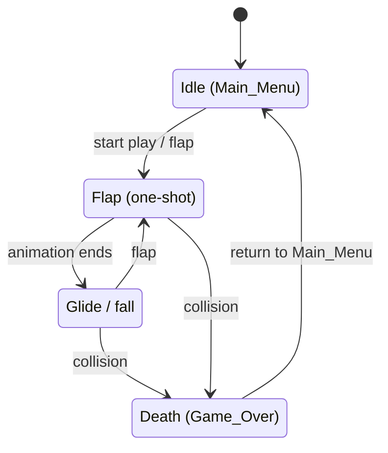

# Ghosty Character Spec

## 1. Overview

Character spec for **Ghosty**, the player-controlled ghost in Flappy Kiro (browser Canvas 2D game, logical canvas 480×640, crisp pixel rendering).

Ghosty is a white pixel-styled ghost that flaps upward against gravity and glides through pipe gaps; it faces right, with two black eyes just right of centre. Existing art: [`assets/ghosty.png`](../../../assets/ghosty.png).

This document defines sprite dimensions, palette, hitbox, animation states, and the state machine. Some values here extend or conflict with the current spec — see [§9 Spec impact](#9-spec-impact). These are now reflected in the spec (Requirements 19–20).

## 2. Sprite dimensions

- **Cell size:** 32×32 logical px (within R12.1's 24–48 px range).
- **Anchor/origin:** cell center `(16, 16)`, which maps to the Ghost position `(x, y)`. The Ghost `x` is fixed at 30% of canvas width; `y` is dynamic. `(x, y)` is always the **center**.
- **Fitting the source asset:** `assets/ghosty.png` is a single frame at 1290×1567 px (aspect ≈ 0.82, not square, not a sprite sheet). Fitting it into a 32×32 cell preserving aspect gives ~**26×32** (width ≈ 26.3), centred horizontally with transparent padding left/right.

**Rendering note:** Do **not** downscale 1290×1567 → 32 every frame with image smoothing disabled — that produces heavy aliasing and jagged edges. Instead:

- **Zero-art-effort option:** pre-render once at load into a 32×32 offscreen canvas with smoothing **on** (high quality), then draw that cached canvas at integer positions with smoothing **off**.
- **Recommended long-term option:** author a proper 32×32 pixel-art sprite sheet (see [§7](#7-proposed-sprite-sheet-layout-optional)) and draw cells at integer positions with smoothing off.

## 3. Palette

| Role | Colour | Notes |
|---|---|---|
| Body | `#FFFFFF` | white ghost silhouette |
| Eyes | `#000000` | two vertical ovals, right of centre |
| Outline (optional) | `#CFE8F5` (light blue) or light grey | 1 px outline for contrast |
| Death tint | red (see [§5](#5-animation-states--frames)) | applied over body during death |

**Contrast risk:** clouds are also white at 0.3–0.8 opacity (R12.3, R12.6). A pure-white ghost on a white cloud can disappear. The optional 1 px outline mitigates this.

## 4. Hitbox

- **Shape:** circle, **radius 12 px**, centred at the sprite center `(16, 16)` → Ghost `(x, y)`.
- **Forgiveness:** diameter 24 vs sprite 32 → ~4 px slack each side; ~1 px horizontally against the ~26 px wide visible body.
- **Rotation-invariant:** the visual tilt (§5) never affects collision, since the circle is symmetric.

**Scale:** the grid below is **32 columns × 16 rows** covering the whole 32×32 px cell. Each **column = 1 px** horizontally; each **row = 2 px** vertically. The `.` padding is **~3 px each side** for the ~26 px wide body; `o` is the visible body outline area, `C` is the r=12 hitbox circle centred at `(16, 16)`, and `+` marks that centre `(x, y)`.

```
32×32 cell — 1 px/column, 2 px/row (16 rows)
+--------------------------------+
|...oooooooooooooooooooooooooo...|
|...oooooooooooooooooooooooooo...|
|...ooooooooCCCCCCCCCCoooooooo...|
|...oooooCCCCCCCCCCCCCCCCooooo...|
|...oooCCCCCCCCCCCCCCCCCCCCooo...|
|...ooCCCCCCCCCCCCCCCCCCCCCCoo...|
|...oCCCCCCCCCCCCCCCCCCCCCCCCo...|
|...oCCCCCCCCCCCC+CCCCCCCCCCCo...|
|...oCCCCCCCCCCCCCCCCCCCCCCCCo...|
|...oCCCCCCCCCCCCCCCCCCCCCCCCo...|
|...ooCCCCCCCCCCCCCCCCCCCCCCoo...|
|...oooCCCCCCCCCCCCCCCCCCCCooo...|
|...oooooCCCCCCCCCCCCCCCCooooo...|
|...ooooooooCCCCCCCCCCoooooooo...|
|...oooooooooooooooooooooooooo...|
|...oooooooooooooooooooooooooo...|
+--------------------------------+
Legend: . = transparent padding (~3 px/side)   o = visible body (~26 px wide)
        C = hitbox circle, r=12 @ (16,16)       + = center (16,16) = (x,y)
```

**Collision tests** (strict; touching = no collision, consistent with the strict AABB overlap in the design):

- **Pipe (circle vs rect):** clamp the circle center to the rect, then collide if squared distance < r²:
  ```
  cx = clamp(x, rect.left, rect.right)
  cy = clamp(y, rect.top,  rect.bottom)
  dx = x - cx;  dy = y - cy
  hit = (dx*dx + dy*dy) < (r*r)      // r = 12
  ```
- **Ground:** `hit if (y + r) > groundY`
- **Ceiling:** `hit if (y - r) < ceilingY`

**Sanity:** pipe gap is 160 px vs the 24 px hitbox diameter — comfortable clearance through a centred gap.

## 5. Animation states & frames

The asset is one frame, so each animation frame is either (a) a cell in a future sprite sheet or (b) a procedural transform of the single image. Both interpretations are given below. All transforms are **visual only** — they never change physics `y` or velocity.

### Idle (Main_Menu) — 4 frames, 150 ms each, loop
| # | Duration | Description | Transform (offsetY / scale / rot / opacity / eyes) |
|---|---|---|---|
| 0 | 150 | rest | offsetY 0, 1.0/1.0, 0°, 1.0, normal |
| 1 | 150 | bob up | offsetY −2, 1.0/1.0, 0°, 1.0, normal |
| 2 | 150 | rest | offsetY 0, 1.0/1.0, 0°, 1.0, normal |
| 3 | 150 | bob down + tail wiggle | offsetY +2, 1.0/1.0, 0°, 1.0, normal |

Bob is a **visual offset only** and never changes physics `y`.

### Flap (Playing, on each Flap) — 3 frames, one-shot, then returns to Glide
| # | Duration | Description | Transform |
|---|---|---|---|
| 0 | 60 | squash | scaleY 0.85 / scaleX 1.1 |
| 1 | 60 | stretch | scaleY 1.1 / scaleX 0.9 |
| 2 | 80 | settle | scaleY 1.0 / scaleX 1.0 |

- Frame 0 **must** appear on the same frame the flap is applied (≤ 50 ms, R3).
- A new flap **restarts** the flap animation from frame 0.
- **Continuous velocity tilt** (visual only, layered on top): interpolate rotation from **−20°** at flap velocity up to **+45°** near terminal velocity, based on `vy`. Keep it simple/linear and clamped to `[-20°, +45°]`.

### Glide/fall (Playing, between flaps) — 1–2 frames, loop (default)
| # | Duration | Description | Transform |
|---|---|---|---|
| 0 | — | neutral glide | 1.0/1.0, velocity tilt applied |
| 1 (opt) | — | subtle tail sway | 1.0/1.0, velocity tilt applied |

### Death (Game_Over) — 4 frames, one-shot, hold final
| # | Duration | Description | Transform |
|---|---|---|---|
| 0 | 80 | hit flash | body tint white→red, 1.0/1.0 |
| 1 | 120 | eyes become "x x" | eyes → x, red tint fading |
| 2 | 60 | shake | offsetX ±1–2 |
| 3 | 60 | shake | offsetX ∓1–2 |
| final | hold | rest, reduced opacity | opacity ~0.7, eyes stay x |

**IMPORTANT (R8.5):** the Ghost vertical position stops updating on Game_Over, so the death animation plays **in place** — no fall-off-screen. A fall/tumble would need a requirement change (see [§9](#9-spec-impact)). **Open decision.**

### Paused (R5.2)
Freeze the current frame and all animation timers. Resume continues from the frozen frame/timer.

## 6. Animation state machine

Animation time uses the same clamped delta time as the game and is **purely presentational** (renderer-side state, not part of the pure simulation), so it does not affect property tests.



## 7. Proposed sprite sheet layout (optional)

For authored pixel art. 32×32 cells, one row per state, 128×128 sheet. Suggested file: `assets/ghosty-sheet.png`.

| Row | State | Cells | Cell coordinates (x, y) |
|---|---|---|---|
| 0 | Idle | 4 | (0,0) (32,0) (64,0) (96,0) |
| 1 | Flap | 3 | (0,32) (32,32) (64,32) |
| 2 | Glide | 2 | (0,64) (32,64) |
| 3 | Death | 4 | (0,96) (32,96) (64,96) (96,96) |

## 8. Accessibility

- Honour `prefers-reduced-motion`: disable idle **bob**, death **shake**, and hit **flash**. Keep the eyes-→x change and the opacity change (non-motion cues).
- Never flash more than **3 times per second** (flash-safety).

## 9. Spec impact

These items are now **applied in the spec**: `requirements.md` (Requirement 12.1 update, Requirement 19 Ghost Sprite and Hitbox, Requirement 20 Ghost Animation), `design.md`, and `tasks.md`.

- [x] `design.md` `DEFAULT_CONFIG` has `ghostWidth`/`ghostHeight` = 36×36 → change to **32×32** (still within R12.1's 24–48).
- [x] `design.md` uses an AABB for the Ghost (`ghostBounds`/`intersects`). A 12 px circle hitbox needs a new `ghostHitboxRadius` config value (schema range e.g. **8–16 and ≤ half the sprite size**), a **circle-vs-rect** collision function, and updated collision property/unit tests. R8's "bounding region" wording already permits a circle.
- [x] Animations are covered by a **requirement** (presentation), a **design section** (renderer-side animator), and **tasks**.
- [x] Death animation must stay **in place** per R8.5 unless that requirement changes (see [§5](#5-animation-states--frames) open decision).
