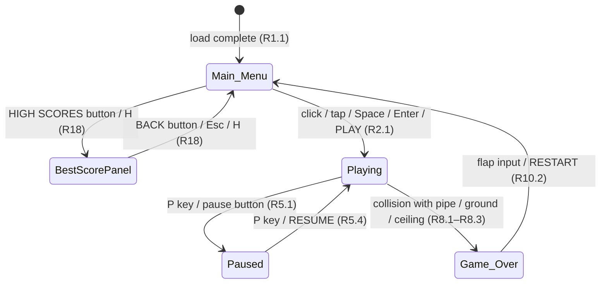

# UI Mockups — Flappy Kiro

Interface mockups for the Flappy Kiro browser game: a retro, pixel-styled endless scroller with a white ghost, green pipes, and a light blue sky with semi-transparent white clouds. These wireframes cover the four Game_States (Main_Menu, Playing, Paused, Game_Over) and the persistent Score_Display, and map each element back to the requirements.

## 1. Shared Elements

These apply across every screen.

### Canvas

- Logical canvas: **480×640 (portrait)**, scaled to the window with crisp/nearest-neighbour pixel rendering.
- All positions below are given in logical canvas units.
- Ghost start position: **30% width, 50% height** (measured from ghost center) (R1.3).

### Colour Palette

| Element | Colour | Notes |
|---|---|---|
| Sky background | `#7EC8E3` | Light blue (R1.4, R12.3) |
| Pipe body | `#2E8B2E` | Green (R6.3, R12.2) |
| Pipe cap (darker) | `#1F6B1F` | Rim at the gap edge |
| Ghost | `#FFFFFF` | White pixel character (R12.1) |
| Clouds | `#FFFFFF` @ 0.3–0.8 opacity | Semi-transparent (R12.3, R12.6) |
| Score bar strip | `#3A4A5C` | Dark slate, persistent bottom bar |
| Score bar text | `#FFFFFF` | White |
| Overlay panel backdrop | `#000000` @ ~0.55 | Semi-transparent dark dimmer |
| Panel surface | `#3A4A5C` | Matches score bar for cohesion |

### Typography

- Font: **"Press Start 2P"** (pixel font), monospace fallback.
- Title: 32 px. Buttons: 20 px. Body / hints: 14 px. HUD score bar: **20 px** (allowed 16–48, R12.4).

### Persistent Bottom Score Bar

- A dark slate strip pinned to the bottom of the canvas, visible in **every** Game_State (R11.1).
- Format: **`Score: N | High: M`** where N is the current Score and M is the High_Score, both non-negative integers (R11.2, R11.3). Matches `img/example-ui.png`.

---

## 2. Main Menu

Shown after load (R1.1). Displays the title, High_Score, start prompt, and the idling ghost at its start position.

```text
+----------------------------------------+
|                       (top is sky)     |
|            .-~-.        .-~~-.          |
|           (cloud)      ( cloud )        |
|                                        |
|            F L A P P Y                  |
|              K I R O                    |
|                                        |
|                (o o)   <- ghost idling  |
|                 \_/     30% w, 50% h    |
|                                        |
|            +----------------+           |
|            |     PLAY       |           |
|            +----------------+           |
|            +----------------+           |
|            |  HIGH SCORES   |  *(new)*  |
|            +----------------+           |
|                                        |
|      Click, tap or press Space          |
|                                        |
+----------------------------------------+
|        Score: 0 | High: 2              |  <- score bar
+----------------------------------------+
```

### Elements

| Element | Position | Size | Behaviour | Refs |
|---|---|---|---|---|
| Title "FLAPPY KIRO" | Center, upper third | 32 px | Static (idle bob may animate) | R1.2 |
| Ghost (idle) | 30% w, 50% h | ~36×36 px | Gentle idle bob (reduced-motion aware) | R1.3, R12.1 |
| Clouds | Scattered upper area | varies | Static/slow drift | R1.4, R12.3, R12.6 |
| Start prompt | Below buttons | 14 px | "Click, tap or press Space" | R1.2, R2.1 |
| Score bar | Bottom strip | full width | Shows `Score: 0 \| High: M` | R1.5, R11.1 |
| [ PLAY ] button | Center | ≥44 px tall | Starts game → Playing (key: Space or Enter) | R2.1 |
| [ HIGH SCORES ] button | Below PLAY | ≥44 px tall | Opens Best score panel (key: H) | R18 |

**PLAY vs. start-anywhere:** A click/tap anywhere or Space/Enter starts the game (R2.1). The PLAY button is consistent with this — it is a visible affordance for the same action. Clicks on the **HIGH SCORES** button (or the H key) must **not** start the game (they open the panel instead).

### Best Score Panel — *Specified in Requirement 18 (Best Score Panel)*

A single best score is persisted in localStorage (there is no leaderboard). The HIGH SCORES button opens a small panel showing that one stored High_Score. While this panel is open, Space/click do **not** start the game; use BACK (Esc or H) to return to the menu first.

```text
+----------------------------------------+
|            +------------------+         |
|            |   BEST SCORE     |         |
|            |                  |         |
|            |       2          |         |
|            |                  |         |
|            |    +--------+    |         |
|            |    |  BACK  |    |         |
|            |    +--------+    |         |
|            +------------------+         |
+----------------------------------------+
|        Score: 0 | High: 2              |
+----------------------------------------+
```

| Element | Position | Size | Behaviour | Refs |
|---|---|---|---|---|
| [ BACK ] button | Panel center | ≥44 px tall | → Main_Menu (key: Esc or H) | R18 |

> **Specified in Requirement 18 (Best Score Panel).** The HIGH SCORES button and Best score panel are covered by Requirement 18, with corresponding **design.md and tasks.md** support. While the panel is open, Space/click do **not** start the game.

---

## 3. In-Game HUD (Playing)

Pipes scroll toward the ghost; the ghost flaps against gravity. HUD is minimal.

```text
+----------------------------------------+
|                              +----+    |
|          2   <- optional     | II |    |  <- pause btn (top-right)
|      (big centred score)     +----+    |
|     ___                        ___     |
|    |   |    .-~-.             |   |     |  <- green pipes
|    |   |   (cloud)            |   |     |
|    |   |          (o o)       |   |     |  <- ghost
|    |___|           \_/         |___|    |
|                                 gap    |
|     ___                        ___     |
|    |   |                       |   |    |
|    |   |                       |   |    |
+----------------------------------------+
|        Score: 2 | High: 2              |  <- score bar
+----------------------------------------+
```

### Elements

| Element | Position | Size | Behaviour | Refs |
|---|---|---|---|---|
| Pipe pairs | Scrolling right→left | 60 px wide, 160 px gap | Move at shared Pipe_Speed | R6.1–R6.5 |
| Ghost | Fixed 30% w, dynamic y | ~36×36 px | Gravity + flap on input | R3, R4, R14 |
| Clouds (parallax) | Background | varies | ≥2 depth layers, slower than pipes | R12.7, R12.8 |
| Pause button | Top-right | ~44×44 px ("II") | Click → Paused | R5.1 |
| Big score (optional) | Top center | 32–48 px | Mirrors current Score | *optional* |
| Score bar | Bottom strip | full width | `Score: N \| High: M` | R7.3, R11.1 |

> The large centred score is **optional** — the persistent bottom bar already satisfies R11. It can be shown for arcade feel without changing scoring behaviour.

### Paused Overlay

Freezes gameplay; preserves exact ghost/pipe positions and velocities (R5.2, R5.3). The pause button becomes a play glyph "▶".

```text
+----------------------------------------+
|                              +----+    |
|                              | >  |    |  <- pause btn now "▶"
|          (scene frozen &     +----+    |
|           dimmed behind)               |
|            +------------------+         |
|            |     PAUSED       |         |
|            |                  |         |
|            | Press P to resume|         |
|            |    +--------+    |         |
|            |    | RESUME |    |         |
|            |    +--------+    |         |
|            +------------------+         |
+----------------------------------------+
|        Score: 2 | High: 2              |
+----------------------------------------+
```

- P key or the on-screen control toggles pause/resume (R5.1, R5.4). Flap inputs are ignored while paused (R5.5).

| Element | Position | Size | Behaviour | Refs |
|---|---|---|---|---|
| Pause button | Top-right | ~44×44 px ("II"/"▶") | Click → toggles Paused | R5.1 |
| [ RESUME ] button | Panel center | ≥44 px tall | → Playing (key: P) | R5.4 |

---

## 4. Game Over

The frozen scene is dimmed behind a centred panel (R8.4, R8.5). Shows final Score, Best, restart prompt.

```text
+----------------------------------------+
|        (frozen scene, dimmed)          |
|            +------------------+         |
|            |    GAME OVER     |         |
|            |                  |         |
|            |   Score:  2      |         |
|            |   Best:   2      |         |
|            |   [ NEW BEST! ]  |         |  <- only if beaten
|            |                  |         |
|            |    +--------+    |         |
|            |    | RESTART|    |         |
|            |    +--------+    |         |
|            | Click, tap, Space|         |
|            +------------------+         |
+----------------------------------------+
|        Score: 2 | High: 2              |
+----------------------------------------+
```

### Elements

| Element | Position | Size | Behaviour | Refs |
|---|---|---|---|---|
| "GAME OVER" heading | Panel top | 32 px | Static | R10.1 |
| Final Score | Panel | 20 px | Shows session Score | R10.1, R9.5 |
| Best | Panel | 20 px | Shows High_Score | R10.1, R9.5 |
| "NEW BEST!" badge | Below Best | 14 px | Only when high score just beaten | R9.1 |
| [ RESTART ] button | Panel center | ≥44 px tall | → Main_Menu (key: Space or Enter) | R10.2 |
| Restart hint | Panel bottom | 14 px | "Click, tap or press Space" | R10.2 |
| Score bar | Bottom strip | full width | `Score: N \| High: M` | R11.1 |

> **Restart returns to Main_Menu**, not directly into Playing (R10.2). Any flap input (click/tap/Space/Enter) or the RESTART button triggers the return; the menu then resets ghost, pipes, and score (R10.3–R10.5).

---

## 5. Screen Flow



Note: `BestScorePanel` and its transitions are specified in Requirement 18 (Best Score Panel). While it is open, Space/click do not start the game.

---

## 6. Accessibility Notes

- **Contrast:** White text on the dark slate score bar (`#3A4A5C`) and panel surfaces provides strong contrast; keep panel text white and avoid low-contrast tints.
- **Touch targets:** All buttons (PLAY, HIGH SCORES, RESUME, RESTART, pause) should be **≥ 44×44 px in displayed size** after scaling.
- **Keyboard equivalents:** Every button has a key so **no action is mouse-only**: PLAY = Space or Enter, HIGH SCORES = H, BACK (Best score panel) = Esc or H, RESTART = Space or Enter, RESUME = P; P also pauses, M mutes; D toggles the Tuning_Panel only with `?debug=1`. While the Best score panel is open, Space/click do **not** start the game — use BACK (Esc or H) first.
- **Don't rely on colour alone:** The "NEW BEST!" badge uses **text** (not just colour) to signal the event.
- **Reduced motion:** Respect `prefers-reduced-motion` for the idle ghost bob and menu/cloud drift animations (reduce or disable).
- **Caveat:** Full WCAG conformance cannot be confirmed from mockups; it requires **manual testing with assistive technologies** and expert review.
